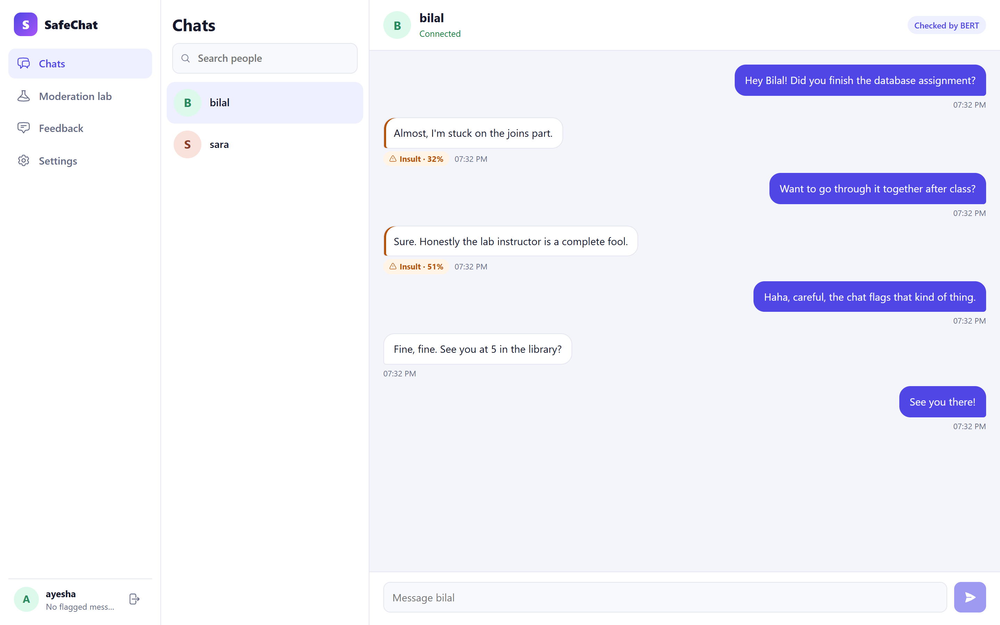
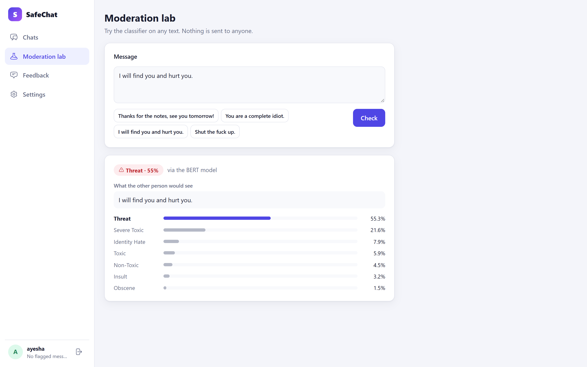
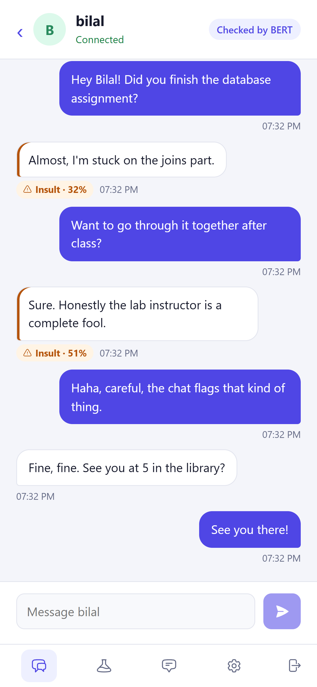
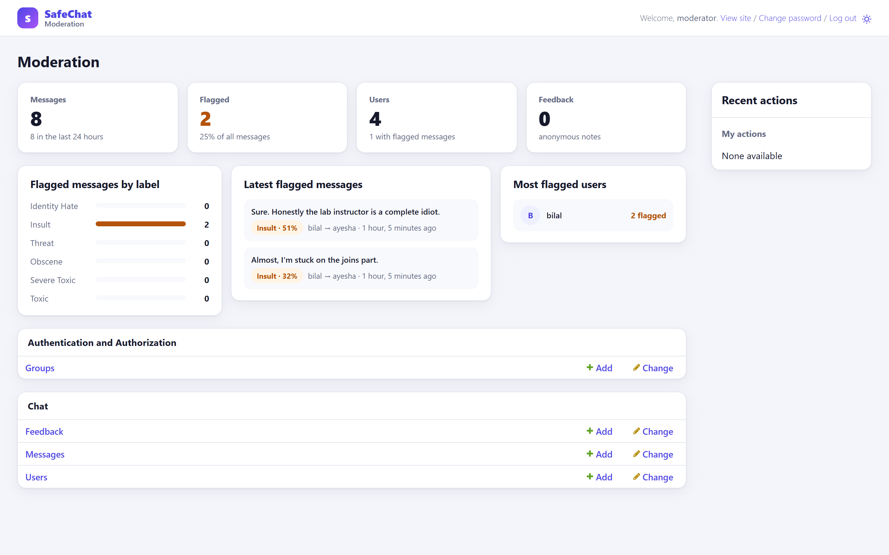
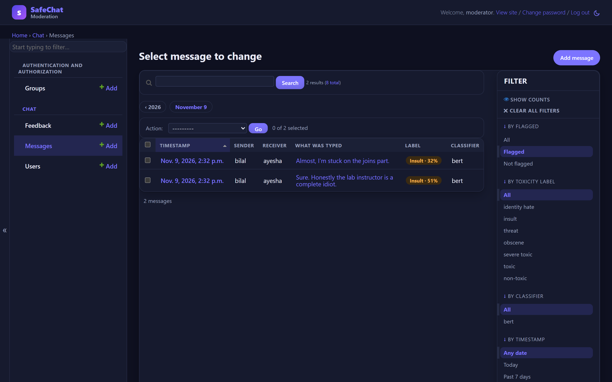
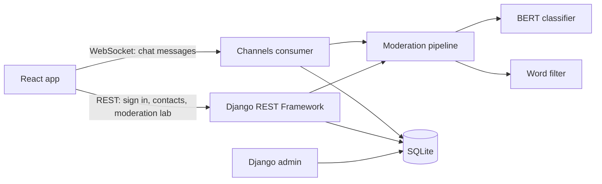

# SafeChat: toxic comment classification for real-time chat

[](https://github.com/Alternat1v3/toxic-comment-classifier/actions/workflows/ci.yml)

A real-time chat app that checks every message with a fine-tuned BERT model. Insults, threats, slurs and other toxic messages are labelled the moment they are sent, offensive words are softened for the person receiving them, and moderators can review everything in the Django admin.

This was my final-year project for the BS Computer Science degree at Virtual University of Pakistan (CS619). I have since rebuilt it with a cleaner architecture, proper authentication, tests and a reproducible training pipeline.



## What it does

- **Real-time chat** over WebSockets (Django Channels).
- **Every message is classified** into one of seven labels: identity hate, insult, threat, obscene, severe toxic, toxic or non-toxic.
- **Offensive words are replaced** with milder ones in what the other person sees ("idiot" becomes "fool"). The original text is kept for moderators.
- **Flagged messages show their label** and the model's confidence, and each user's flagged messages are counted.
- **Moderation lab**: try the classifier on any text and see the probability of every label.
- **Moderation dashboard** in the Django admin, in the same design as the chat (light and dark): flagged messages by label, the latest flags with what was really typed, the most flagged users, and every message filterable by label.

<table>
  <tr>
    <td></td>
    <td width="28%"></td>
  </tr>
</table>

<table>
  <tr>
    <td></td>
    <td></td>
  </tr>
</table>

## How it works



For every message, the server:

1. classifies the text as typed with the BERT model (in a worker thread, so other chats keep flowing),
2. replaces offensive words using a word list (whole words only, so "skills" is never touched),
3. saves what was shown, what was typed, the label and the confidence,
4. sends the message to both people in the conversation.

The sender always comes from the signed-in session, never from the browser, and you can only open conversations you are part of.

## The model

| | |
|---|---|
| Base model | `bert-base-uncased`, fine-tuned for 7-way classification (PyTorch + Hugging Face Transformers) |
| Data | 246 short, hand-labelled chat messages in [`ml/data/train.csv`](ml/data/train.csv), 32 to 42 per label |
| Split | 80/20, stratified by label, seed 42: 196 messages for training, 50 held out |
| Training | 10 epochs, batch size 16, learning rate 3e-5, about 4 minutes on a 4-core i3 CPU (`python ml/train.py`) |

### How good is it?

It is measured on two sets of messages it never saw while training:

- **Held-out split**: the 50 messages from the original data that training never touched ([`ml/results/metrics.json`](ml/results/metrics.json)).
- **Fresh messages**: 42 new messages written later, 6 per label, including harder cases such as hate without slurs and harmless idioms like "my phone battery is killing me" ([`ml/data/challenge.csv`](ml/data/challenge.csv)).

| Model | Exact label, held-out split (50) | Exact label, fresh messages (42) | Flag or not, fresh messages |
|---|---|---|---|
| **Used by the app** (10 epochs) | **60.0%** (macro F1 0.59) | **83.3%** (macro F1 0.82) | **42 of 42** |
| Longer training (25 epochs, learning rate 5e-5) | 54.0% (macro F1 0.53) | 81.0% (macro F1 0.81) | 42 of 42 |
| Original 2024 model | not measurable: it trained on most of these | 81.0% (macro F1 0.80) | 40 of 42 |

What the numbers say:

- **It is reliable at deciding whether to flag a message.** On the fresh messages it flagged every toxic one and none of the harmless ones, including the idioms. The 2024 model flagged "my phone battery is killing me" as a threat.
- **It is unreliable at saying which kind of toxic.** On the held-out split it is strong on threat (F1 0.93), non-toxic (0.88) and obscene (0.75), and weak on severe toxic (0.31), toxic (0.33) and identity hate (0.40). The dataset uses those labels for very similar sentences, so the model cannot learn a clear line between them. Every mistake on the fresh messages is of this kind, for example "You're useless at everything" (toxic) labelled insult.
- **It also flags some harmless messages that look nothing like its training data.** In the screenshot at the top, "Almost, I'm stuck on the joins part." is flagged as an insult, at 32% confidence. The training set has only 42 harmless examples, mostly short pleasantries, so ordinary sentences with a negative tone can look toxic to it. Requiring more confidence before flagging does not help: the model gives that sentence only a 14% chance of being harmless, and a threshold misses many real insults whose confidence is split between similar labels.
- **Training longer made it worse** on the held-out split, because it memorised the training sentences (training loss 0.005). The app uses the 10-epoch model, which is what `python ml/train.py` produces. All three runs are in [`ml/results/runs/`](ml/results/runs).

**Be careful reading these numbers.** The dataset is tiny and made of short, explicit sentences, and the test sets are small: one message is 2% of the held-out split. The labels also overlap ("toxic", "severe toxic" and "insult" describe similar messages), which is where most mistakes happen. The model will not handle sarcasm, context across messages, misspellings meant to dodge filters, or languages other than English. A production system would need a large dataset such as the [Jigsaw toxic comments](https://www.kaggle.com/c/jigsaw-toxic-comment-classification-challenge) (about 160,000 comments). `ml/train.py` accepts any CSV with `content` and `label` columns, so training on more data needs no code changes, and `ml/evaluate.py` scores any model on any labelled CSV.

**A bug worth knowing about.** On Windows, PyTorch 2.4.0 computed softmax wrongly whenever it used more than one CPU thread: on a 4-core i3 the result was off in 122 of 150 runs, while matrix multiplication stayed correct. Attention then returned NaN, so the server labelled every message "identity hate", and training learned nothing (the loss stayed at chance level). PyTorch 2.5.1 fixes it, so `requirements-ml.txt` requires it, and both the server and `train.py` check softmax against float64 at startup. If the check fails, the server falls back to the keyword list instead of returning nonsense.

## Run it locally

You need Python 3.11 and Node.js 18 or newer.

**1. Server**

```bash
cd server
python -m venv .venv
.venv\Scripts\activate          # Windows; on macOS/Linux: source .venv/bin/activate
pip install -r requirements-ml.txt
cp .env.example .env            # Windows: copy .env.example .env
python manage.py migrate
python manage.py runserver
```

`requirements-ml.txt` installs PyTorch and Transformers (about 1 GB). For a lighter install, use `requirements.txt`: the app then checks messages with the keyword list only.

**2. Model**

The trained weights (about 420 MB) are too large for GitHub, so train them yourself:

```bash
python ../ml/train.py           # from the server folder; writes ml/model and ml/results
```

Until a model exists, the server falls back to the keyword list and says so in the chat header.

**3. Demo data**

```bash
python manage.py seed_demo --with-admin   # users ayesha, bilal and sara, plus a "moderator" admin; password demo-pass-2024
```

The moderation dashboard is at http://localhost:8000/admin/ (sign in as `moderator`). `--with-admin` is only for trying it locally; on a real server, create the admin with `python manage.py createsuperuser`.

**4. Frontend**

```bash
cd frontend
npm install
npm start
```

Open http://localhost:3000 and sign in as `ayesha` / `demo-pass-2024`. Open a second browser window as `bilal` to chat in real time.

## Configuration

Settings come from environment variables or `server/.env` (see [`.env.example`](server/.env.example)).

| Variable | Default | What it does |
|---|---|---|
| `DJANGO_DEBUG` | `false` | Development mode. Never enable it in production. |
| `DJANGO_SECRET_KEY` | none | Required when debug is off. |
| `DJANGO_ALLOWED_HOSTS` | `localhost,127.0.0.1` | Hosts the server answers to. |
| `CORS_ALLOWED_ORIGINS` | `http://localhost:3000` | Where the React app runs. |
| `REDIS_URL` | none | Redis for WebSockets, needed with more than one server process. Without it, an in-memory layer is used. |
| `TOXICITY_MODEL_DIR` | `ml/model` | Folder with the fine-tuned model. |
| `TORCH_THREADS` | all cores | CPU threads for the model. |

The frontend reads `REACT_APP_API_URL` (default `http://localhost:8000`).

## API

| Method | Path | |
|---|---|---|
| `GET` | `/api/auth/csrf/` | Sets the CSRF cookie |
| `POST` | `/api/auth/register/` | Create an account (username, email, password, optional photo) |
| `POST` | `/api/auth/login/`, `/api/auth/logout/` | Session sign-in and sign-out |
| `GET` | `/api/auth/me/` | The signed-in user |
| `GET` | `/api/users/` | Other users (no emails) |
| `GET` | `/api/conversations/<username>/` | Your messages with one user |
| `POST` | `/api/moderation/check/` | Classify text without sending it |
| `GET` | `/api/moderation/status/` | Whether BERT or the keyword list is in use |
| `POST` | `/api/feedback/` | Anonymous feedback |

Everything except sign-up and sign-in requires a session. Chat runs over `ws://localhost:8000/ws/chat/<username>/`: the client sends `{"message": "..."}`; the server sends the history once, then each new message with its label and confidence.

## Tests

```bash
cd server && python manage.py test      # 38 tests: API, privacy, WebSocket chat, classifier, word filter, admin
cd frontend && npm test
```

GitHub Actions runs both on every push. The server tests use the keyword classifier, so they run without PyTorch or the model.

## Project structure

```
server/                 Django project
  backend/              settings, URLs, ASGI (HTTP + WebSockets)
  chat/                 models, REST API, WebSocket consumer, admin and its dashboard
    moderation/         BERT classifier, keyword fallback, word filter
    management/         seed_demo, export_messages
    tests/
  templates/admin/      admin pages in the chat app's design
  static/admin/         the admin theme (safechat.css)
frontend/               React app (Create React App)
  src/pages/            sign in, chats, moderation lab, feedback, settings
ml/
  data/train.csv        labelled messages
  train.py              fine-tuning and evaluation
  results/              scores and test-set predictions
docs/screenshots/
```

## What changed since the original version

- Tracked down why every message was labelled "identity hate" (a PyTorch 2.4.0 softmax bug on Windows) and added a startup check for it.
- Closed privacy holes: conversations and user details were readable without signing in, and anyone could read or send messages as another user over the WebSocket.
- One user model (the original mixed two), a fresh database schema, and settings from environment variables instead of a hard-coded secret key.
- Word filter matches whole words only, case-insensitively.
- Reproducible training with a held-out test set, and honest scores.
- Rebuilt interface with a dark mode, a phone layout and the moderation lab.
- The admin panel now uses the chat app's design and opens on a moderation dashboard, built on Django's own admin instead of the Jazzmin theme.
- Tests and continuous integration.
